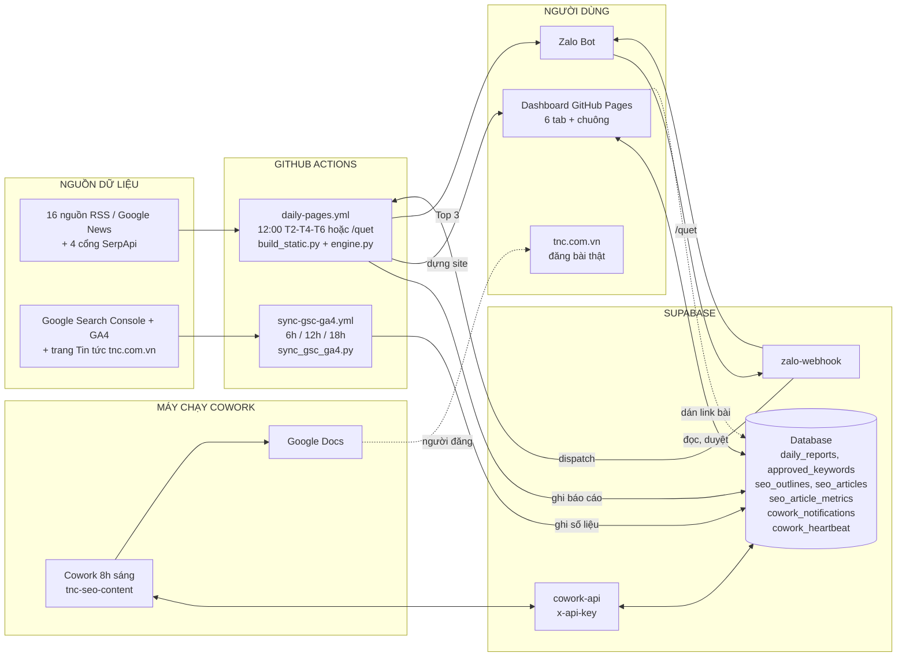
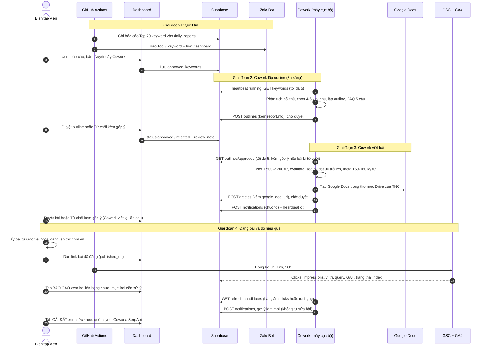

# TÀI LIỆU SƠ ĐỒ HỆ THỐNG TNC SEO KEYWORD NEWS (KEY_TNC)

Phiên bản 3.0, cập nhật 31/10/2026. Thay đổi lớn nhất so với bản cũ: **Cowork chạy cục bộ** (lập outline, viết bài, tạo Google Docs), chuông thông báo trên Dashboard, và **đo hiệu quả bài bằng Google Search Console + GA4**.

---

## 📌 Các file sơ đồ trong thư mục này

| File | Dùng để |
|---|---|
| [`he_thong_tnc_seo_architecture.html`](he_thong_tnc_seo_architecture.html) | Sơ đồ tương tác (mở bằng trình duyệt, có nút In / Lưu PDF) |
| [`infographic_agent_tnc.html`](infographic_agent_tnc.html) | Infographic dạng poster của hệ thống Agent |
| [`SO_DO_HE_THONG_TNC_SEO.pdf`](SO_DO_HE_THONG_TNC_SEO.pdf) / [`.png`](SO_DO_HE_THONG_TNC_SEO.png) | Bản xuất sẵn của sơ đồ hệ thống (gửi Zalo, in ấn) |
| [`SO_DO_INFOGRAPHIC_AGENT_TNC.pdf`](SO_DO_INFOGRAPHIC_AGENT_TNC.pdf) / [`.png`](SO_DO_INFOGRAPHIC_AGENT_TNC.png) | Bản xuất sẵn của infographic |

---

## 🗺️ 1. Kiến trúc tổng thể

---

## ⏰ 2. Ai chạy khi nào (giờ Việt Nam)

| Tác vụ | Chạy ở đâu | Lịch | Cách kiểm tra |
|---|---|---|---|
| Quét tin + chấm điểm | GitHub Actions `daily-pages.yml` | 12:00 thứ 2, 4, 6; chạy tay; hoặc `/quet` trên Zalo | Tab Actions xanh; Dashboard hiện "Cập nhật lần cuối" đúng giờ |
| Cowork lập outline + viết bài | Máy chạy Cowork (scheduled task) | 8:00 mỗi ngày (`0 8 * * *`) | Dòng "Cowork chạy lần cuối" trên Dashboard (đỏ nếu quá 26 giờ hoặc báo lỗi) |
| Đồng bộ GSC + GA4 | GitHub Actions `sync-gsc-ga4.yml` | 6:00, 12:00, 18:00 mỗi ngày | Cột `synced_at`, `data_end_date` trong `seo_article_metrics` |
| Lệnh Zalo | `zalo-webhook` | Khi nhắn `/quet` hoặc `/top` | Bot trả lời "Đã gọi quét" hoặc lỗi GitHub |

---

## 📂 3. Nhiệm vụ từng file & thư mục

### `backend/` (xử lý dữ liệu, chấm điểm)
- `engine.py`: nhạc trưởng. Chấm 100 điểm, chọn **Top 20 keyword**, mỗi keyword 5 bài + 3 gợi ý. Nhóm "Có thể quan tâm" luôn xếp cuối.
- `news_fetcher.py`: quét **16 nguồn** RSS / Google News trong 48h (báo công nghệ, shop đối thủ, Google News theo chủ đề AI, game, chính sách số).
- `classifier.py`: gán 1 trong **9 nhóm chủ đề** (Linh kiện - Phần cứng, HĐH - Phần mềm, Có thể quan tâm, Game, A.I, Mạng xã hội - App, Chính sách - Quy định, An ninh mạng, Tối ưu - Sửa lỗi) và nhận diện brand.
- `serpapi_client.py`: 4 cổng SerpApi, mỗi cổng 1 lượt/ngày, cache `data/serpapi_daily_*.json`. Gói Free có 250 lượt/tháng; mỗi lần quét tốn 4 lượt.
- `seo_suggester.py`: gợi ý 3 keyword / tiêu đề.

### `frontend/`, `data/`, `site/`
- `frontend/index.html`: Dashboard 1 trang, **6 tab**: Dashboard Keyword, Keyword Duyệt, Workflow, Báo cáo, Đề xuất, **Cài đặt**. Tab Báo cáo có khung "Bài cần xử lý" nằm cạnh biểu đồ (giảm clicks, tụt hạng, CTR thấp, chưa index; so 14 ngày gần nhất với 14 ngày trước, bỏ ngày cuối; phân trang 3 bài/trang; bài Cowork ★ luôn xếp trước và có nút lọc Tất cả nguồn / Bài Cowork / Bài khác; bài giảm clicks hoặc tụt hạng được đánh dấu NÊN LÀM MỚI). Bảng đo lường hiệu năng mặc định xếp "Bài mới nhất (ngày xuất bản)", không còn cột Audit. Menu trái là dải màu tím đậm. Tab Cài đặt là thẻ sức khỏe hệ thống (lần quét, lần sync GSC+GA4, Cowork, lượt SerpApi). Có chuông thông báo của Cowork và dòng "Cowork chạy lần cuối".
- `data/latest_top10_report.json`: báo cáo mới nhất ghi trên máy chạy (tên giữ cũ nhưng chứa 20 keyword).
- `site/`: bản tĩnh sinh tự động để đăng GitHub Pages (không commit).

### `database/` (chạy trong Supabase SQL Editor)
- `auth_postgres.sql`, `admin_only_users.sql`: đăng nhập; chỉ tài khoản được duyệt mới đọc `daily_reports`.
- `seo_content.sql`: `seo_outlines`, `seo_articles` (có ghi chú góp ý `review_note`, link bài đã đăng `published_url`).
- `approved_keywords.sql`: keyword đã duyệt.
- `cowork_notifications.sql`, `cowork_heartbeat.sql`: chuông thông báo và nhịp hoạt động của Cowork.
- `seo_articles_google_doc.sql`: cột link Google Docs.
- `seo_article_metrics.sql`: số liệu GSC + GA4 từng bài.
- `zalo_messages.sql`: bảng log tin Zalo.

### `supabase/functions/` (Edge Functions)
- `cowork-api`: API cho Cowork, xác thực bằng `x-api-key`: `GET /keywords`, `POST /outlines`, `GET /outlines/approved`, `POST /articles`, `POST /notifications`, `POST /heartbeat`, `GET /refresh-candidates` (bài nên làm mới, tối đa 10 bài).
- `zalo-webhook`: nhận tin Zalo; lệnh `/quet` (gọi GitHub chạy quét) và `/top`. Chỉ nhận lệnh từ đúng `ZALO_CHAT_ID`.

### `cowork/`, `.github/`, file ở thư mục gốc
- `cowork/COWORK_TASK.md`: hướng dẫn cài đặt và prompt của scheduled task Cowork.
- `.github/workflows/daily-pages.yml`: quét + dựng GitHub Pages.
- `.github/workflows/sync-gsc-ga4.yml`: đồng bộ GSC + GA4 (không tốn token AI).
- `build_static.py`: quét, đẩy báo cáo, báo Zalo, dựng `site/`. `--ui-only` chỉ dựng giao diện; `--reuse` dựng lại từ file local và **không ghi lên Supabase**.
- `sync_gsc_ga4.py`: (ngày cuối dữ liệu `data_end_date` = ngày GSC thật sự có số, không phải hôm nay) kéo GSC + GA4 cho bài trong 60 ngày của danh mục Tin tức và bài của dashboard.
- `sync_reports.py`: đồng bộ bù `report.md` từ `seo_output` lên Supabase.
- `tests/test_core.py`: 5 bài kiểm thử khớp keyword và độ tươi.
- `.env`: khóa bí mật (không commit). GitHub Secrets cần có: `SERPAPI_API_KEY`, `SUPABASE_URL`, `SUPABASE_ANON_KEY`, `SUPABASE_SERVICE_KEY`, `ZALO_BOT_TOKEN`, `ZALO_CHAT_ID`, `GOOGLE_SERVICE_ACCOUNT_JSON`.

---

## ⚡ 4. Chu kỳ vận hành end-to-end

Người duyệt 3 lần (keyword, outline, bài). **Cowork không bao giờ tự duyệt.**

**Quy tắc của Cowork** (theo `cowork/COWORK_TASK.md`): mỗi lần chạy tối đa 5 keyword và 5 outline; Phần C chỉ **đề xuất** làm mới tối đa 3 bài cũ qua chuông (không tự sửa bài, không đẩy outline/bài mới); dùng đúng 100% key phụ trong outline đã duyệt; điểm SEO ≥ 90; không để link trong bài; gặp mã 409 (đã có) thì bỏ qua; lỗi tạo Google Docs hoặc gửi thông báo không làm dừng cả lần chạy.

---

## 🎯 5. Công thức chấm điểm từ khóa (thang 100)

Tại `backend/engine.py`:

| Tiêu chí | Điểm | Ý nghĩa |
|---|---|---|
| **Độ phủ báo chí** | **40** | Nhiều báo cùng đưa tin trong 24-48h thì chủ đề càng nóng. |
| **Đối thủ đã viết** | **25** | GearVN, CellphoneS, Phong Vũ, FPT Shop, Thế Giới Di Động... đã lên bài. |
| **Độ tươi mới** | **20** | Tin dưới 6 giờ được điểm tối đa, giảm dần theo tuổi tin. |
| **Xác thực SerpApi** | **15** | Trending Now và Google Trends (chỉ đo thật cho 5 ứng viên đầu do giới hạn quota). |

---

## 🛠️ 6. Khi nghi ngờ có chỗ không chạy

| Triệu chứng | Kiểm tra | Thường do |
|---|---|---|
| Dashboard hiện giờ cập nhật cũ | Tab Actions có run xanh của `daily-pages`? Bảng `daily_reports` dòng hôm nay, cột `updated_at` | Chạy tay `build_static.py` trên máy ghi đè (nay `--reuse` đã không ghi nữa); hoặc chạy chế độ chỉ giao diện |
| Cowork không ra outline / bài | Dòng "Cowork chạy lần cuối" và chuông trên Dashboard | Máy tắt lúc 8h, thiếu `COWORK_API_KEY` trong `.env`, hoặc chưa duyệt keyword / outline |
| Không thấy nút XEM REPORT | Outline có `research.report_md` chưa? | Chạy `python sync_reports.py --apply` |
| Số liệu BÁO CÁO chưa có / lệch | `seo_article_metrics`: `synced_at`, `data_end_date`; bài đã dán `published_url` chưa | Chưa dán link bài; Google trễ 1-2 ngày; bài chưa được index |
| Zalo không báo | Secret `ZALO_BOT_TOKEN`, `ZALO_CHAT_ID`; nhật ký `zalo-webhook` | Sai chat id, token hết hạn |
| Không rõ tác vụ nào đang trễ | Tab **Cài đặt** trên Dashboard: 4 thẻ (quét tin, sync GSC+GA4, Cowork, SerpApi); đỏ hoặc vàng là cần xử lý | Xem hướng dẫn xử lý ngay dưới các thẻ |
| Hết lượt SerpApi | Ô quota trên Dashboard (còn bao nhiêu / 250) | Chạy tay quá nhiều; mỗi lần quét tốn 4 lượt |
