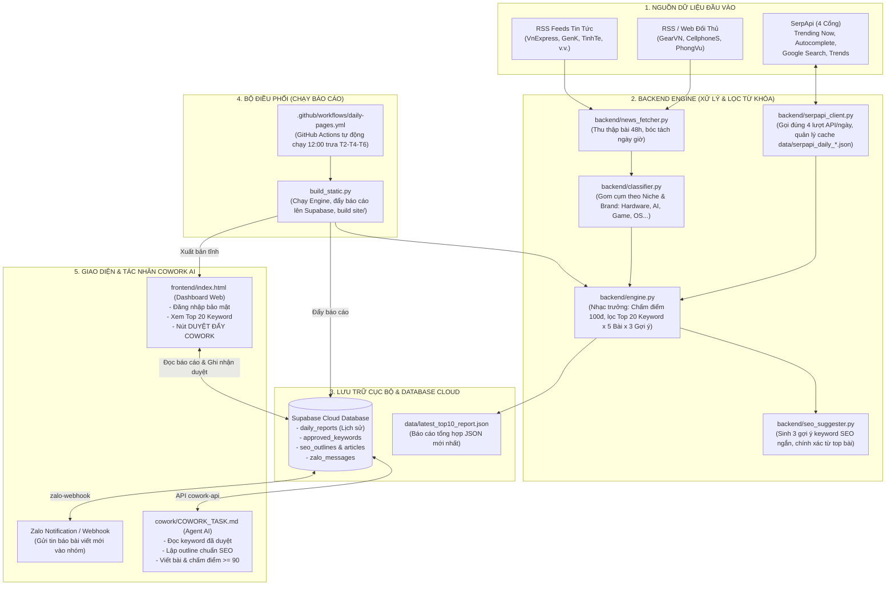
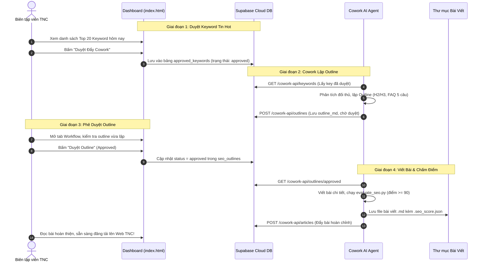

# TÀI LIỆU SƠ ĐỒ HỆ THỐNG TNC SEO KEYWORD NEWS (KEY_TNC)

Tài liệu này hệ thống hóa toàn bộ kiến trúc file, thư mục, vai trò nhiệm vụ và các luồng tương tác dữ liệu trong dự án.

---

## 📌 Các File Sơ Đồ Đã Được Xuất Sẵn

Bạn có thể mở hoặc gửi các file này trực tiếp cho người khác:
1. **File Ảnh Sơ Đồ (PNG):** [`SO_DO_HE_THONG_TNC_SEO.png`](file:///C:/Users/Duong%20Trang/Documents/GEMNI%20ANTIGRAVITY/tnc-seo-keyword-news-github/docs/SO_DO_HE_THONG_TNC_SEO.png) (Gửi nhanh qua Zalo/Telegram/Email)
2. **File Tài Liệu In Ấn (PDF):** [`SO_DO_HE_THONG_TNC_SEO.pdf`](file:///C:/Users/Duong%20Trang/Documents/GEMNI%20ANTIGRAVITY/tnc-seo-keyword-news-github/docs/SO_DO_HE_THONG_TNC_SEO.pdf) (In ấn, báo cáo, đính kèm tài liệu)
3. **File Sơ Đồ Tương Tác Web (HTML):** [`he_thong_tnc_seo_architecture.html`](file:///C:/Users/Duong%20Trang/Documents/GEMNI%20ANTIGRAVITY/tnc-seo-keyword-news-github/docs/he_thong_tnc_seo_architecture.html) (Mở trên trình duyệt, có nút In/Lưu PDF)

---

## 🗺️ 1. Sơ Đồ Kiến Trúc Luồng Dữ Liệu Tổng Thể

---

## 📂 2. Nhiệm Vụ Cụ Thể Từng File & Thư Mục

### 📁 `backend/` (Xử lý dữ liệu & Thuật toán tính điểm)
- [`backend/engine.py`](file:///C:/Users/Duong%20Trang/Documents/GEMNI%20ANTIGRAVITY/tnc-seo-keyword-news-github/backend/engine.py): **Nhạc trưởng điều phối (Orchestrator)**. Tổng hợp dữ liệu từ RSS và SerpApi, chấm điểm theo thang 100, tuyển chọn đúng **Top 20 Keyword** có tiềm năng nhất và **5 bài viết đại diện** mới nhất cho mỗi keyword.
- [`backend/news_fetcher.py`](file:///C:/Users/Duong%20Trang/Documents/GEMNI%20ANTIGRAVITY/tnc-seo-keyword-news-github/backend/news_fetcher.py): Quét tin tức RSS tự động từ 11 nguồn báo chí công nghệ (VnExpress, GenK, Tinhte...) và website đối thủ (GearVN, CellphoneS, Phong Vũ...). Phân tích ngày giờ phát hành để lọc bài trong 24h - 48h.
- [`backend/classifier.py`](file:///C:/Users/Duong%20Trang/Documents/GEMNI%20ANTIGRAVITY/tnc-seo-keyword-news-github/backend/classifier.py): Phân loại và gán thẻ theo 5 nhóm ngành (Hardware, AI, Gaming, OS/Software, Sự kiện công nghệ) và nhận diện các Brand (Nvidia, Intel, AMD, Apple, Asus...).
- [`backend/serpapi_client.py`](file:///C:/Users/Duong%20Trang/Documents/GEMNI%20ANTIGRAVITY/tnc-seo-keyword-news-github/backend/serpapi_client.py): Kết nối với 4 cổng API của SerpApi (Google Trends Trending Now, Google Autocomplete, Google Search, Google Trends). Chỉ gọi tối đa 1 lần/ngày/cổng và lưu cache để tiết kiệm chi phí quota.
- [`backend/seo_suggester.py`](file:///C:/Users/Duong%20Trang/Documents/GEMNI%20ANTIGRAVITY/tnc-seo-keyword-news-github/backend/seo_suggester.py): Phân tích nội dung tiêu đề các bài viết top và dữ liệu Autocomplete để sinh ra 3 từ khóa phụ / tiêu đề gợi ý viết bài chuẩn SEO.

---

### 📁 `frontend/` (Giao diện Dashboard Web)
- [`frontend/index.html`](file:///C:/Users/Duong%20Trang/Documents/GEMNI%20ANTIGRAVITY/tnc-seo-keyword-news-github/frontend/index.html): Ứng dụng Single Page Application (SPA) viết bằng Tailwind CSS:
  - Hỗ trợ đăng nhập phân quyền bảo mật qua Supabase Auth.
  - Hiển thị danh sách Top 20 từ khóa kèm điểm số chi tiết, bộ lọc theo ngành hàng, danh sách bài viết đối thủ.
  - Tích hợp giao diện quản lý quy trình (Workflow) và nút **"Duyệt Đẩy Cowork"**.
- [`frontend/logo.png`](file:///C:/Users/Duong%20Trang/Documents/GEMNI%20ANTIGRAVITY/tnc-seo-keyword-news-github/frontend/logo.png): Logo thương hiệu TNC Store.

---

### 📁 `data/` (Kho Dữ Liệu)
- [`data/latest_top10_report.json`](file:///C:/Users/Duong%20Trang/Documents/GEMNI%20ANTIGRAVITY/tnc-seo-keyword-news-github/data/latest_top10_report.json): Báo cáo tổng hợp JSON mới nhất của ngày.
- [`data/serpapi_daily_YYYY-MM-DD.json`](file:///C:/Users/Duong%20Trang/Documents/GEMNI%20ANTIGRAVITY/tnc-seo-keyword-news-github/data): File cache lưu kết quả gọi 4 cổng SerpApi theo từng ngày.
- [`data/workflow.json`](file:///C:/Users/Duong%20Trang/Documents/GEMNI%20ANTIGRAVITY/tnc-seo-keyword-news-github/data/workflow.json): Lưu trạng thái duyệt và nội dung bài viết khi làm việc ở chế độ offline.

---

### 📁 `database/` & 📁 `supabase/` (Cơ Sở Dữ Liệu & Cloud Functions)
- [`database/auth_postgres.sql`](file:///C:/Users/Duong%20Trang/Documents/GEMNI%20ANTIGRAVITY/tnc-seo-keyword-news-github/database/auth_postgres.sql): Cấu hình bảo mật Supabase Auth, quản lý bảng người dùng và chính sách RLS.
- [`database/admin_only_users.sql`](file:///C:/Users/Duong%20Trang/Documents/GEMNI%20ANTIGRAVITY/tnc-seo-keyword-news-github/database/admin_only_users.sql): Phân quyền chỉ tài khoản được Admin duyệt mới có quyền đọc báo cáo.
- [`database/seo_content.sql`](file:///C:/Users/Duong%20Trang/Documents/GEMNI%20ANTIGRAVITY/tnc-seo-keyword-news-github/database/seo_content.sql): Bảng dữ liệu chính phục vụ Cowork: `approved_keywords` (keyword đã duyệt), `seo_outlines` (outline bài viết) và `seo_articles` (nội dung bài viết hoàn chỉnh).
- [`database/zalo_messages.sql`](file:///C:/Users/Duong%20Trang/Documents/GEMNI%20ANTIGRAVITY/tnc-seo-keyword-news-github/database/zalo_messages.sql): Bảng lưu log các thông báo gửi sang Zalo.
- [`supabase/functions/cowork-api/index.ts`](file:///C:/Users/Duong%20Trang/Documents/GEMNI%20ANTIGRAVITY/tnc-seo-keyword-news-github/supabase/functions/cowork-api/index.ts): API Endpoint bảo mật bằng `x-api-key` để Agent AI Cowork lấy keyword đã duyệt và đẩy outline/bài viết lên.
- [`supabase/functions/zalo-webhook/index.ts`](file:///C:/Users/Duong%20Trang/Documents/GEMNI%20ANTIGRAVITY/tnc-seo-keyword-news-github/supabase/functions/zalo-webhook/index.ts): Webhook tự động bắn tin nhắn thông báo vào nhóm Zalo khi có bài viết hoặc keyword mới.

---

### 📁 `cowork/` & 📁 `.github/` & File Khởi Động
- [`cowork/COWORK_TASK.md`](file:///C:/Users/Duong%20Trang/Documents/GEMNI%20ANTIGRAVITY/tnc-seo-keyword-news-github/cowork/COWORK_TASK.md): Tài liệu hướng dẫn và câu lệnh Prompt lập lịch hàng ngày cho Agent AI tự động:
  1. Quét keyword đã duyệt.
  2. Lập outline chuẩn SEO (FAQ 5 câu, H2/H3).
  3. Viết bài chi tiết và chấm điểm SEO $\ge 90$ trước khi đẩy lên hệ thống.
- [`.github/workflows/daily-pages.yml`](file:///C:/Users/Duong%20Trang/Documents/GEMNI%20ANTIGRAVITY/tnc-seo-keyword-news-github/.github/workflows/daily-pages.yml): GitHub Actions tự động chạy lúc **12:00 trưa giờ VN** vào các ngày Thứ 2, Thứ 4, Thứ 6 (hoặc chạy tay bằng nút Run workflow). Tự động chạy `build_static.py`, nạp báo cáo lên Supabase và cập nhật GitHub Pages.
- [`build_static.py`](file:///C:/Users/Duong%20Trang/Documents/GEMNI%20ANTIGRAVITY/tnc-seo-keyword-news-github/build_static.py): Script thực hiện chạy engine, tải báo cáo lên Supabase và xuất bản thư mục `site/` cho GitHub Pages.
- [`tests/test_core.py`](file:///C:/Users/Duong%20Trang/Documents/GEMNI%20ANTIGRAVITY/tnc-seo-keyword-news-github/tests/test_core.py): Bộ kiểm thử tự động (Unit Test) kiểm tra thuật toán so khớp từ khóa và tính độ tươi của tin tức.

---

## ⚡ 3. Chu Trình Hoạt Động (End-to-End Workflow)

---

## 🎯 4. Công Thức Tính Điểm Từ Khóa (Thang 100 Điểm)

Tại [`backend/engine.py`](file:///C:/Users/Duong%20Trang/Documents/GEMNI%20ANTIGRAVITY/tnc-seo-keyword-news-github/backend/engine.py), điểm số của mỗi từ khóa được tính toán tự động dựa trên 4 trọng số:

| Tiêu chí | Trọng số | Ý nghĩa & Cách tính |
|---|---|---|
| **Độ phủ báo chí** | **40%** | Số lượng báo lớn (VnExpress, GenK, Tinhte...) đồng loạt đưa tin trong 24h - 48h. |
| **Đối thủ cạnh tranh** | **25%** | Số lượng đối thủ bán lẻ (GearVN, CellphoneS, Phong Vũ...) đã lên bài về chủ đề này. |
| **Độ tươi mới** | **20%** | Tin ra dưới 6 giờ được điểm tối đa; điểm giảm dần theo số giờ tuổi của tin. |
| **Xác thực SerpApi** | **15%** | Xuất hiện trên Google Trends Trending Now và chỉ số tìm kiếm thực tế trên Google. |
